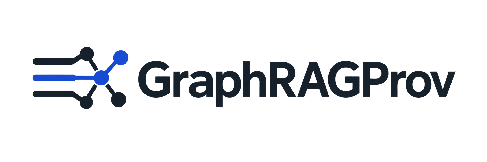

<p align="center">
  
</p>

Ask questions over text-derived knowledge graphs. Inspect executed SPARQL,
how-provenance polynomials, and the exact source spans behind each answer.

### Abstract

>
> GraphRAG systems often use knowledge graphs to retrieve relevant context for an LLM that produces the final answer. That makes answers more inscrutable and therefore less appealing for domains where transparency is paramount. We present GraphRAGProv, an architecture that executes SPARQL queries over source-grounded RDF graphs to compute answers and their how-provenance polynomials. These polynomials record which statement occurrences were used and how they were combined. Because each occurrence is linked to its source text, users can follow these links to check whether the extracted statements reflect the text and whether the query combines them to answer the question. Querying thereby becomes a way to inspect and evaluate the text-to-graph transformation. Our interactive demo examines 400 cases from two multi-hop QA benchmarks, revealing extraction and query errors even when the final answer is correct.

## Run

Requires Git and Docker Compose.

```bash
git clone https://github.com/wadie999/graphragprov.git
cd graphragprov
git submodule update --init --recursive
mkdir -p secrets
```

Request a [GraphDB Free license](https://graphdb.ontotext.com/).
Save the license for GraphDB 11.3.1 as:

```text
secrets/graphdb.license
```

Then start:

```bash
export DEEPSEEK_API_KEY="your-api-key"
docker compose up --build
```

Open **http://localhost:8080**.

The API key is needed for LLM extraction and question-to-SPARQL generation.
Inspecting saved results and executing existing SPARQL do not require it.

Stop with `Ctrl+C`. Restart with the same command.

## Experiments

Configure datasets and experiments in `workbench.toml`.

| Folder | Contents |
|---|---|
| `experiments/cohorts/` | Selected case IDs and cohort datasets |
| `experiments/runs/` | Experiment outputs |
| `external/benchmarks/` | Benchmark datasets |

Dataset and run paths must exist inside the container.
Configure their mounts in `compose.yaml`.

## Development

With Docker services running, develop the frontend with live reload:

```bash
cd frontend
npm ci
npm run dev
```

Open **http://localhost:5173**. API requests go to the backend on port 8080.

After Python or deployment changes, rebuild:

```bash
docker compose up --build
```

## Built on

GraphRAGProv uses [SparqlProv](https://github.com/wadie999/sparql-prov), our Rust implementation of the [NPCS method](https://doi.org/10.1145/3589334.3645557). The original Java implementation is available in the [NPCS repository](https://github.com/ZubariaForthAcc/NPCS).
  
## Citation

```bibtex
@misc{amrani2026graphragprovgraphragmeetshowprovenance,
      title={GraphRAGProv: GraphRAG Meets How-Provenance}, 
      author={Wadie El Amrani and Luis Galárraga},
      year={2026},
      eprint={2610.37237},
      archivePrefix={arXiv},
      primaryClass={cs.AI},
      url={https://arxiv.org/abs/2610.37237}, 
}
```
